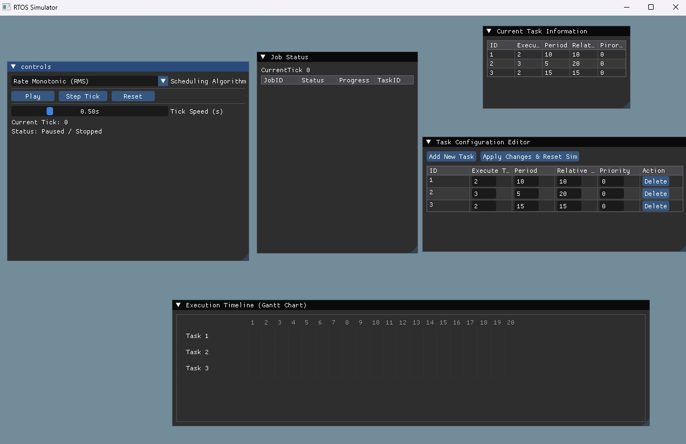
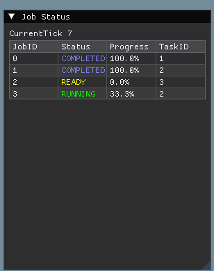
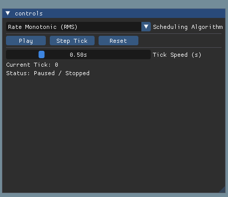
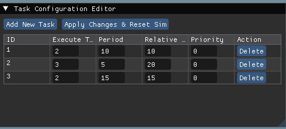
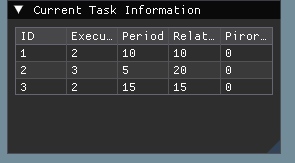
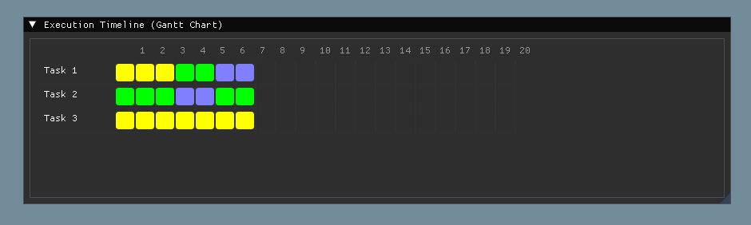

# RTOS Scheduler Simulator

[](https://en.cppreference.com/w/cpp/20)
[](https://www.opengl.org/)
[](https://github.com/ocornut/imgui)
[](https://www.glfw.org/)
[](https://github.com/yourusername/RTOSScheduler)

An interactive, desktop-based Real-Time Operating System (RTOS) scheduling simulator built from scratch in **C++20**. Designed to model, evaluate, and visualize real-time scheduling policies with a hardware-agnostic simulation engine and a high-performance **Dear ImGui / OpenGL** user interface.

---

## 🚀 Key Features

* **Multiple Real-Time Schedulers:** Modular architecture supporting core scheduling algorithms:
  * **Rate Monotonic Scheduling (RMS):** Static priority assignment based on task periods.
  * **Earliest Deadline First (EDF):** Dynamic priority scheduling prioritizing tasks with the nearest absolute deadlines.
  * **Fixed Priority Preemptive Scheduling (FPPS):** Classic fixed-priority multitasking model.
* **Interactive GUI Dashboard:** Built using **Dear ImGui** and **GLFW/OpenGL** for instantaneous visual feedback and telemetry.
* **Runtime Control & Debugging:**
  * **Runtime Scheduler Switching:** Dynamically swap scheduling policies on the fly without restarting the simulation.
  * **Tick Engine Control:** Play/Stop toggle for continuous execution or step-by-step analysis via a **Next Tick** button.
* **Modern C++20 & Strict Compilation:** Written with modern C++ features, target-based CMake design, and high warning levels (`-Wall -Wextra -Wpedantic` / `/W4`).
* **Automated Testing:** Integrated unit test suite via `CTest` for validating scheduling correctness and edge cases.

---

## 🛠️ System Architecture

The project is structured around a clean separation of concerns, decoupling the underlying simulation kernel from the graphics and user interface layer:

```text
+-------------------------------------------------------+
|                Dear ImGui / OpenGL GUI                |
|           (Editor.cpp, Runtime Controls)              |
+-------------------------------------------------------+
|                 Simulation Core Layer                 |
|       (Simulator.cpp, Task States, Tick Engine)       |
+-------------------------------------------------------+
|                   Scheduler Modules                   |
|      (RMS, EDF, and FPPS Polymorphic Implementations) |
+-------------------------------------------------------+
```

## 💡 Design Rationale & Architecture Decisions

This simulator was engineered with a strict focus on **separation of concerns** and **testability**

1. **Decoupled Simulation Core & UI Layer**
   * *Why:* The simulation kernel (Tick Engine, Task States, and scheduling algorithms) has zero dependencies on Dear ImGui, GLFW, or OpenGL. 
   * *Benefit:* This enables **headlessly running unit tests via CTest** without requiring an active window context, ensuring fast and reliable automated test pipelines.

2. **Polymorphic Scheduler Interface**
   * *Why:* Scheduling algorithms (RMS, EDF, FPPS) inherit from a common abstract base interface.
   * *Benefit:* Adheres to the **Open-Closed Principle**, making the architecture extensible. New scheduling policies (e.g., Least-Laxity-First) can be plugged in without modifying core engine code.

3. **Value-Based State Snapshots (`SimulatorDisplayData`)**
   * *Why:* Rather than passing live references or pointers to internal mutable simulation state, the kernel packages display telemetry into a value-copied struct (`SimulatorDisplayData`).
   * *Benefit:* Eliminates data races, prevents mid-frame mutation bugs, and provides a safe, isolated data snapshot for the UI layer—laying a robust foundation for future multi-threaded concurrency (separating the simulation tick thread from the render thread).

## 📸 Visualizations & UI

### Initial Application
Initial Application


### Job Status
Job Status window tracking current job status for current frame


### Main Control
Main Control for current frame


### Task Configuration
Allows user to change current task configuration with
apply and reset to actually apply changes


### Task Info
show current task information


### Execution Timeline (Gantt Chart)
Custom-rendered multi-tick timeline tracking task states (`RUNNING(Green)`, `READY(Yellow)`, `COMPLETED(Blue)`) alongside an explicit CPU Idle row.


---

## 🎮 Controls & Usage

| Control / Button | Action / Description |
| :--- | :--- |
| **Play / Pause** (`Space`) | Toggles automated tick progression at the configured interval. |
| **Step Tick** (`Right Arrow`) | Manually advances the simulation forward by exactly 1 tick. |
| **Reset** (`R`) | Clears history records, resets `m_currentTick` to 0, and resets task states. |
| **Scheduler Selector** | Switch dynamically between **RMS**, **EDF**, and **FPPS** algorithms. |
| **Task Configuration Table** | Edit task periods, execution times, and priorities on the fl

## 👤 Author

**Goh Jun Lin Wayne**  
* [GitHub Profile]
* [LinkedIn Profile]